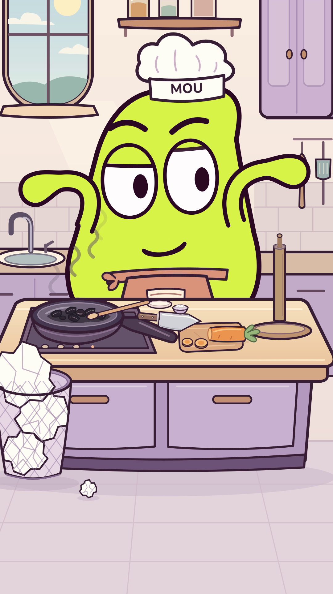

# MOU

**Just cooking. Mostly washing. — V26, 38 secondes.**

MOU cuisine, se lave et gaspille du papier. Il tente de résister à son rituel,
mais finit plus fier de ses mains impeccables que de son repas brûlé.
L'animation progresse du jeu retenu aux réactions cartoon ; la fin présente
les deux moufles avec le plat noir, la fumée et la poubelle débordante.

[](episodes/03/cuisine_v26/MOU_Encore_une_feuille.mp4?raw=true)

- **[Film avec son — 1080 × 1920](episodes/03/cuisine_v26/MOU_Encore_une_feuille.mp4?raw=true)**
- [Aperçu de la fin — 8 secondes](episodes/03/cuisine_v26/MOU_test_mise_en_scene.mp4?raw=true)
- [Version muette](episodes/03/cuisine_v26/MOU_Encore_une_feuille_muette.mp4?raw=true)
- [Sources ZIP](episodes/03/cuisine_v26/MOU_Encore_une_feuille_sources.zip?raw=true)
- [Découpage, critiques et contrôles](episodes/03/cuisine_v26/)
- [Bibliothèque d'expressions : 36 poses](bibliotheque/expressions/v1/)

Le modèle, la toque « MOU », le tablier de taille et les deux moufles sont
conservés. Jazz piano-contrebasse continu, bruitages courts synchronisés et
sifflement seulement au départ. La production utilise des outils gratuits
et open source. Le modèle ne peut pas écouter : les mesures ne certifient
pas le confort sonore. La critique par images n'est pas un test public.

[V25 rejetée](episodes/03/cuisine_v25/) · [V24 rejetée](episodes/03/cuisine_v24/) ·
[V23](episodes/03/cuisine_v23/) · [Versions précédentes](episodes/03/).
[Réexamen éditorial](episodes/03/developpement/reprise_editoriale/) ·
[Référence Lamput examinée](recherche/2026-10-30_lamput/) ·
[Outils libres et essais](recherche/2026-10-29_professionnel/).
Les épisodes abandonnés restent conservés :
[Le retardateur](episodes/01_reprise/), [Le torchon](episodes/02/).

## Équipe et dossier de création

[Règles durables et rôles](AGENTS.md) · [Profils Codex](.codex/config.toml) ·
[Compatibilité](equipe/compatibilite_agents.md) · [Coordination](equipe/README.md).
Les rôles sont appliqués par mandats distincts dans la session ; la présence
des fichiers ne prouve pas leur activation native dans tous les clients.

- [Archives : scénario et découpage du Torchon](episodes/02/developpement/)
- [Critique avant fabrication](episodes/02/developpement/critique_scenario.md) et [critique du montage rendu](episodes/02/controle/critique_montage.md)
- [Critiques initiales conservées](episodes/01_reprise/controle/critique.md)
- [Archives : corrections retenues](episodes/02/developpement/corrections.md)
- [Veille datée et limites](editorial/veille_2026-10-27.md) · [Suivi après diffusion](publication/README.md)

Outils de production gratuits/open source : Python, SVG, CairoSVG, Pillow,
NumPy, FFmpeg et FluidSynth. Partition originale, banque d’instruments libre
[FluidR3 MIT créditée](episodes/03/cuisine_v23/assets/FluidR3_README.md), bruitages originaux ; trois notes sifflées
uniquement au départ, aucun dialogue ni musique téléchargée.
La [recherche de réalisation actuelle](recherche/2026-10-29_professionnel/README.md)
conserve les essais et les preuves d’accès. Aucune statistique, écoute ou
observation d’une vidéo inaccessible n’est inventée. Les critiques par images
et les contrôles audio numériques ne valent pas test public ou écoute sur téléphone.

## Base du projet

Base de lancement de la série de courts gags visuels de MOU.

Le personnage vert à deux yeux est retenu. Ce dossier contient le modèle
articulé utilisé dans le test, sa référence, les contrôles et les consignes
pour fabriquer le premier épisode.

## Commencer

Lire `AGENTS.md`, `BRIEF_MOU_CODEX.txt` puis `PILOTE_01.txt`.
Le texte à transmettre à Codex est dans `DEMARRER_CODEX.txt`.

## Reproduire le test déjà livré

Prérequis : Python 3.11 ou plus, FFmpeg et les bibliothèques système nécessaires
à CairoSVG/Cairo. La police DejaVu fournie dans `fonts` permet de conserver
le lettrage lorsqu'elle est installée sur le système de rendu.

```bash
python3 -m pip install -r requirements.txt
python3 verification.py --preview
python3 verification.py
```

La première commande de rendu produit une planche. La seconde exporte les
216 images de travail et le test de neuf secondes avec son.

## Repères

- `mou_rig.py` : géométrie paramétrique du personnage.
- `verification.py` : poses, transitions, sons et export du test.
- `references/MOU_reference.png` : étude visuelle de référence.
- `references/MOU_intentions_12.png` : intentions de jeu de l'ancienne planche ;
  suivre le modèle vérifié pour les raccords des bras et des mains.
- `output/MOU_verification_9_secondes.mp4` : test de construction.
- `output/MOU_controle_des_poses.png` : poses extraites du test.
- `output/RAPPORT_VERIFICATION.txt` : contrôles effectués et limites.
- `SOURCES.txt` : références et liens techniques.

Les poses SVG et les sons du test se régénèrent avec le script.
Le montage courant et ses sources se trouvent dans `episodes/03/cuisine_v26/`.

La référence visuelle est une illustration ; le rig est son interprétation
vectorielle. Le test vérifie des expressions et des raccords, sans mesurer
l'intérêt comique auprès d'un public.
