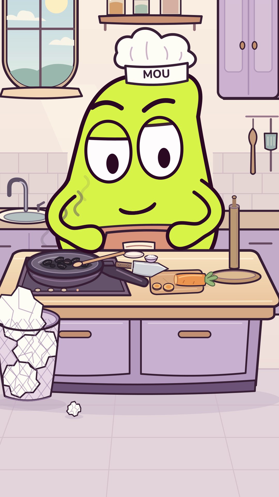

# MOU

**Épisode de cuisine avec le nouveau galet — 38 secondes.**

**[Voir l'épisode avec son](episodes/03/galet_cuisine_v1/Galet_Cuisine.mp4?raw=true)** ·
[Version muette](episodes/03/galet_cuisine_v1/Galet_Cuisine_muette.mp4?raw=true) ·
[Sources et contrôles](episodes/03/galet_cuisine_v1/).

Carotte, tomate, sel, quatre lavages et trop de papier. Le repas brûle pendant
que le chef soigne ses moufles, puis il présente fièrement ses mains propres.
Nouveau personnage aux mains flottantes, décor et costume conservés.

**Nouveau prototype : le petit galet aux moufles flottantes.**
Le concept a été sélectionné par l'utilisatrice ; le dessin et le jeu restent
à juger. Nom de travail Galet, première palette citron, essai muet de cinq secondes.

[Dessin](personnages/galet_v1/Galet_reference.png) ·
[Voir le test](personnages/galet_v1/Galet_miette_muette.mp4?raw=true) ·
[Six poses](personnages/galet_v1/Galet_poses.png) ·
[Sources et contrôles](personnages/galet_v1/).

La [recherche du 31 octobre](recherche/2026-10-31_codex_animation/) explique
cette proposition. Les anciens épisodes MOU restent conservés ; la V29 cuisine
interrompue n'est pas relancée. V28 demeure archivée ci-dessous, avec des mains
et positions jugées encore insuffisantes par l'utilisatrice.

**Cuisine V28 — mains et gestes de souffle corrigés, 38 secondes.**

Les moufles restent devant le torse, sous la bouche. Deux mouvements de bouche
suivent les souffles existants ; aucun décalage global du son n'est appliqué.
La musique, les bruitages et le WAV complet V27 sont conservés exactement.

[](episodes/03/cuisine_v28/MOU_Encore_une_feuille.mp4?raw=true)

- **[Film avec son](episodes/03/cuisine_v28/MOU_Encore_une_feuille.mp4?raw=true)**
- [Fin corrigée — 8 secondes](episodes/03/cuisine_v28/MOU_test_mise_en_scene.mp4?raw=true)
- [Avant/après des mains](episodes/03/cuisine_v28/controle/planche_mains_avant_apres.png)
- [Version muette](episodes/03/cuisine_v28/MOU_Encore_une_feuille_muette.mp4?raw=true)
- [Sources et contrôles](episodes/03/cuisine_v28/)

**[Bibliothèque de sons — 12 propositions à écouter](bibliotheque/sons/v1/)**

[Audition vidéo — 18 secondes](bibliotheque/sons/v1/MOU_Bibliotheque_Sons_v1.mp4?raw=true) ·
[Catalogue autonome ZIP](bibliotheque/sons/v1/MOU_Bibliotheque_Sons_v1.zip?raw=true).
Extraire le ZIP puis ouvrir index.html pour écouter séparément les sons.
Six intentions, deux variantes ; aucune voix définitive n'est encore choisie.
Les ancres d'énergie aident à placer les sons, sans prouver l'émotion perçue.

[Bibliothèque d'expressions — 36 poses](bibliotheque/expressions/v1/) ·
[V27 sonore conservée](episodes/03/cuisine_v27/) · [V26](episodes/03/cuisine_v26/) ·
[Versions précédentes](episodes/03/).
Les assets CC0 sont documentés, avec limites sur leur auteur et procédé.
Le modèle ne peut pas écouter : les contrôles ne certifient pas le confort sonore.
Production avec des logiciels gratuits et open source.

## Équipe et dossier de création

[Règles durables et rôles](AGENTS.md) · [Profils Codex](.codex/config.toml) ·
[Compatibilité](equipe/compatibilite_agents.md) · [Coordination](equipe/README.md).
Les rôles sont appliqués par mandats distincts dans la session ; la présence
des fichiers ne prouve pas leur activation native dans tous les clients.

- [Archives : scénario et découpage du Torchon](episodes/02/developpement/)
- [Critique avant fabrication](episodes/02/developpement/critique_scenario.md) et [critique du montage rendu](episodes/02/controle/critique_montage.md)
- [Critiques initiales conservées](episodes/01_reprise/controle/critique.md)
- [Archives : corrections retenues](episodes/02/developpement/corrections.md)
- [Veille datée et limites](editorial/veille_2026-10-27.md) · [Suivi après diffusion](publication/README.md)

Outils de production gratuits/open source : Python, SVG, CairoSVG, Pillow,
NumPy, FFmpeg et FluidSynth. Partition originale, banque d’instruments libre
[FluidR3 MIT créditée](episodes/03/cuisine_v23/assets/FluidR3_README.md), bruitages originaux et matières libres créditées ; trois notes sifflées
uniquement au départ, aucun dialogue ni musique téléchargée.
La [recherche de réalisation actuelle](recherche/2026-10-29_professionnel/README.md)
conserve les essais et les preuves d’accès. Aucune statistique, écoute ou
observation d’une vidéo inaccessible n’est inventée. Les critiques par images
et les contrôles audio numériques ne valent pas test public ou écoute sur téléphone.

## Base du projet

Base de lancement de la série de courts gags visuels de MOU.

Le personnage vert à deux yeux est retenu. Ce dossier contient le modèle
articulé utilisé dans le test, sa référence, les contrôles et les consignes
pour fabriquer le premier épisode.

## Commencer

Lire `AGENTS.md`, `BRIEF_MOU_CODEX.txt` puis `PILOTE_01.txt`.
Le texte à transmettre à Codex est dans `DEMARRER_CODEX.txt`.

## Reproduire le test déjà livré

Prérequis : Python 3.11 ou plus, FFmpeg et les bibliothèques système nécessaires
à CairoSVG/Cairo. La police DejaVu fournie dans `fonts` permet de conserver
le lettrage lorsqu'elle est installée sur le système de rendu.

```bash
python3 -m pip install -r requirements.txt
python3 verification.py --preview
python3 verification.py
```

La première commande de rendu produit une planche. La seconde exporte les
216 images de travail et le test de neuf secondes avec son.

## Repères

- `mou_rig.py` : géométrie paramétrique du personnage.
- `verification.py` : poses, transitions, sons et export du test.
- `references/MOU_reference.png` : étude visuelle de référence.
- `references/MOU_intentions_12.png` : intentions de jeu de l'ancienne planche ;
  suivre le modèle vérifié pour les raccords des bras et des mains.
- `output/MOU_verification_9_secondes.mp4` : test de construction.
- `output/MOU_controle_des_poses.png` : poses extraites du test.
- `output/RAPPORT_VERIFICATION.txt` : contrôles effectués et limites.
- `SOURCES.txt` : références et liens techniques.

Les poses SVG et les sons du test se régénèrent avec le script.
Le montage courant et ses sources se trouvent dans `episodes/03/cuisine_v28/`.

La référence visuelle est une illustration ; le rig est son interprétation
vectorielle. Le test vérifie des expressions et des raccords, sans mesurer
l'intérêt comique auprès d'un public.
