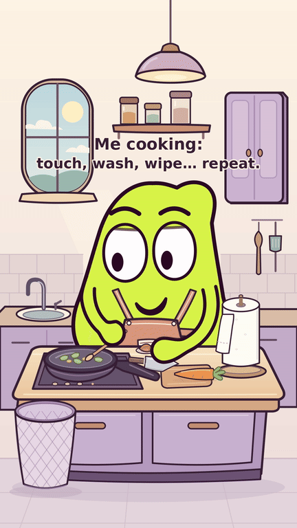

# MOU

**Encore une feuille — jazz cartoon discret, 41 secondes.**

MOU remue, coupe la carotte, ajoute la tomate puis une pincée de sel.
Chaque contact relance son nettoyage et son gaspillage de papier, jusqu’au
dernier petit bout. Les gros plans montrent la moufle au pouce arrondi validé,
avec un petit frottement sous le jet et le poignet dégagé.
Le jeu souligne sa première inquiétude, sa détermination devant le dernier
papier et sa fierté finale devant sa main propre et la poubelle pleine.

Légende d’ouverture : **« Me cooking: touch, wash, wipe… repeat. »**
Sifflement au départ seulement ; nouvelle musique originale de jazz cartoon
discret, avec contrebasse et accords doux, coupée pendant chaque lavage et
essuyage. Images et bruitages conservés.

[](episodes/03/cuisine_v15/MOU_Encore_une_feuille.mp4?raw=true)

- **[Voir le MP4 avec son, 1080 × 1920](episodes/03/cuisine_v15/MOU_Encore_une_feuille.mp4?raw=true)**
- [Avant/après de la musique](episodes/03/cuisine_v15/comparaison/)
- [Version muette](episodes/03/cuisine_v15/MOU_Encore_une_feuille_muette.mp4?raw=true)
- [Sources ZIP](episodes/03/cuisine_v15/MOU_Encore_une_feuille_sources.zip?raw=true) · [Bilan des contrôles](episodes/03/cuisine_v15/CONTROLE.txt)
- [Chronologie](episodes/03/cuisine_v15/chronologie.json) · [Critiques et corrections](episodes/03/cuisine_v15/controle/)
- [V14 avec l’ancienne musique conservée](episodes/03/cuisine_v14/)
- [V13 précédente de 41 s conservée](episodes/03/cuisine_v13/)
- [Version précédente de 35 s conservée](episodes/03/cuisine_v6/) · [Version de 30 s](episodes/03/carotte_v5/)
- [Décor validé](episodes/03/decor/) · [Placement](episodes/03/placement/) · [Test de remuage](episodes/03/test_remuer/)

Les épisodes abandonnés restent conservés :
[Le retardateur](episodes/01_reprise/), [Le torchon](episodes/02/).

## Équipe et dossier de création

[Règles durables et rôles](AGENTS.md) · [Profils Codex](.codex/config.toml) ·
[Compatibilité](equipe/compatibilite_agents.md) · [Coordination](equipe/README.md).
Les rôles sont appliqués par mandats distincts dans la session ; la présence
des fichiers ne prouve pas leur activation native dans tous les clients.

- [Archives : scénario et découpage du Torchon](episodes/02/developpement/)
- [Critique de la fin avant fabrication](episodes/02/developpement/critique_scenario_fin_v3.md) et [critique du montage rendu](episodes/02/controle/critique_montage.md)
- [Critiques initiales conservées](episodes/01_reprise/controle/critique.md)
- [Archives : corrections retenues](episodes/02/developpement/corrections.md)
- [Veille datée et limites](editorial/veille_2026-10-27.md) · [Suivi après diffusion](publication/README.md)

Outils de production gratuits/open source : Python, SVG, CairoSVG, Pillow,
NumPy, FFmpeg et FluidSynth. Partition originale, banque d’instruments libre
[TimGM6mb créditée](episodes/03/cuisine_v15/assets/README.md), bruitages originaux ; trois notes sifflées
uniquement au départ, aucun dialogue ni musique téléchargée.
La [veille de cette révision](episodes/03/cuisine_v6/editorial/veille_cuisine_v6.md)
reste partielle : une vidéo de cuisine examinée par images et une boucle CSS lue.
YouTube reste bloqué par le réseau courant ; les accès sont préparés dans
un brouillon à enregistrer puis publier dans les paramètres cloud. Aucune statistique ni visionnage n’est inventé. La critique par images
et les contrôles audio numériques ne valent pas test public ou écoute sur téléphone.

## Base du projet

Base de lancement de la série de courts gags visuels de MOU.

Le personnage vert à deux yeux est retenu. Ce dossier contient le modèle
articulé utilisé dans le test, sa référence, les contrôles et les consignes
pour fabriquer le premier épisode.

## Commencer

Lire `AGENTS.md`, `BRIEF_MOU_CODEX.txt` puis `PILOTE_01.txt`.
Le texte à transmettre à Codex est dans `DEMARRER_CODEX.txt`.

## Reproduire le test déjà livré

Prérequis : Python 3.11 ou plus, FFmpeg et les bibliothèques système nécessaires
à CairoSVG/Cairo. La police DejaVu fournie dans `fonts` permet de conserver
le lettrage lorsqu'elle est installée sur le système de rendu.

```bash
python3 -m pip install -r requirements.txt
python3 verification.py --preview
python3 verification.py
```

La première commande de rendu produit une planche. La seconde exporte les
216 images de travail et le test de neuf secondes avec son.

## Repères

- `mou_rig.py` : géométrie paramétrique du personnage.
- `verification.py` : poses, transitions, sons et export du test.
- `references/MOU_reference.png` : étude visuelle de référence.
- `references/MOU_intentions_12.png` : intentions de jeu de l'ancienne planche ;
  suivre le modèle vérifié pour les raccords des bras et des mains.
- `output/MOU_verification_9_secondes.mp4` : test de construction.
- `output/MOU_controle_des_poses.png` : poses extraites du test.
- `output/RAPPORT_VERIFICATION.txt` : contrôles effectués et limites.
- `SOURCES.txt` : références et liens techniques.

Les poses SVG et les sons du test se régénèrent avec le script.
Le montage courant et ses sources se trouvent dans `episodes/03/cuisine_v13/`.

La référence visuelle est une illustration ; le rig est son interprétation
vectorielle. Le test vérifie des expressions et des raccords, sans mesurer
l'intérêt comique auprès d'un public.
