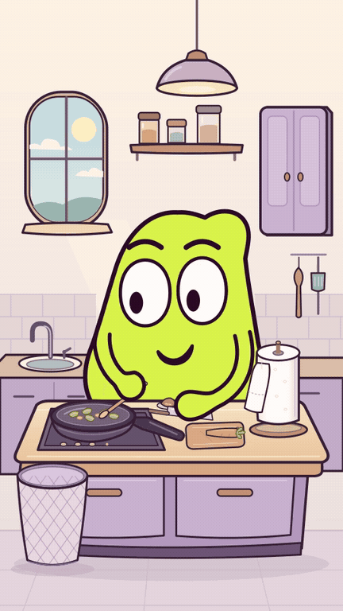

# MOU

**Encore une feuille — version carotte avec son, 29 secondes.**
MOU remue, ajoute une tomate et découpe une carotte. Chaque petit contact
déclenche un lavage et beaucoup trop de papier. Les quatre rituels accélèrent,
la poubelle se remplit ; à la fin, une main tente d’arrêter l’autre.

[](episodes/03/carotte_v4/MOU_Encore_une_feuille.mp4?raw=true)

- **[Voir le MP4 avec son,1080×1920](episodes/03/carotte_v4/MOU_Encore_une_feuille.mp4?raw=true)**
- [Version muette](episodes/03/carotte_v4/MOU_Encore_une_feuille_muette.mp4?raw=true)
- [Sources ZIP](episodes/03/carotte_v4/MOU_Encore_une_feuille_sources.zip?raw=true) · [Bilan des contrôles](episodes/03/carotte_v4/CONTROLE.txt)
- [Chronologie](episodes/03/carotte_v4/chronologie.json) · [Critiques et corrections](episodes/03/carotte_v4/controle/)
- [Direction de jeu et expressions](episodes/03/developpement/expressions_v4/) · [Recherche d’outils gratuits](recherche/README.md)
- [Montage précédent de 26 s conservé](episodes/03/film/)
- [Placement validé](episodes/03/placement/) · [Décor validé](episodes/03/decor/)

Le décor, le placement et le [test de remuage](episodes/03/test_remuer/) validés
restent conservés. Le montage complet est proposé au jugement de l’utilisatrice.

Les anciens épisodes sont conservés, mis de côté :
[Le retardateur](episodes/01_reprise/), [Le torchon](episodes/02/).

## Équipe et dossier de création

[Règles durables et rôles](AGENTS.md) · [Profils Codex](.codex/config.toml) ·
[Compatibilité](equipe/compatibilite_agents.md) · [Coordination](equipe/README.md).
Les rôles sont appliqués par mandats distincts dans la session ; la présence
des fichiers ne prouve pas leur activation native dans tous les clients.

- [Archives : scénario et découpage du Torchon](episodes/02/developpement/)
- [Critique de la fin avant fabrication](episodes/02/developpement/critique_scenario_fin_v3.md) et [critique du montage rendu](episodes/02/controle/critique_montage.md)
- [Critiques initiales conservées](episodes/01_reprise/controle/critique.md)
- [Archives : corrections retenues](episodes/02/developpement/corrections.md)
- [Veille datée et limites](editorial/veille_2026-10-27.md) · [Suivi après diffusion](publication/README.md)

Outils de production gratuits/open source : Python, SVG, CairoSVG, Pillow,
NumPy et FFmpeg. Quarante-huit événements sonores originaux dans ce montage,
sans voix ni musique externe.
La veille externe reste incomplète car YouTube n’est pas autorisé par le réseau
courant. Aucune statistique ni visionnage n’est inventé. La critique par images
et les contrôles audio numériques ne valent pas test public ou écoute sur téléphone.

## Base du projet

Base de lancement de la série de courts gags visuels de MOU.

Le personnage vert à deux yeux est retenu. Ce dossier contient le modèle
articulé utilisé dans le test, sa référence, les contrôles et les consignes
pour fabriquer le premier épisode.

## Commencer

Lire `AGENTS.md`, `BRIEF_MOU_CODEX.txt` puis `PILOTE_01.txt`.
Le texte à transmettre à Codex est dans `DEMARRER_CODEX.txt`.

## Reproduire le test déjà livré

Prérequis : Python 3.11 ou plus, FFmpeg et les bibliothèques système nécessaires
à CairoSVG/Cairo. La police DejaVu fournie dans `fonts` permet de conserver
le lettrage lorsqu'elle est installée sur le système de rendu.

```bash
python3 -m pip install -r requirements.txt
python3 verification.py --preview
python3 verification.py
```

La première commande de rendu produit une planche. La seconde exporte les
216 images de travail et le test de neuf secondes avec son.

## Repères

- `mou_rig.py` : géométrie paramétrique du personnage.
- `verification.py` : poses, transitions, sons et export du test.
- `references/MOU_reference.png` : étude visuelle de référence.
- `references/MOU_intentions_12.png` : intentions de jeu de l'ancienne planche ;
  suivre le modèle vérifié pour les raccords des bras et des mains.
- `output/MOU_verification_9_secondes.mp4` : test de construction.
- `output/MOU_controle_des_poses.png` : poses extraites du test.
- `output/RAPPORT_VERIFICATION.txt` : contrôles effectués et limites.
- `SOURCES.txt` : références et liens techniques.

Les poses SVG et les sons du test se régénèrent avec le script.
Le montage courant et ses sources se trouvent dans `episodes/03/carotte_v4/`.

La référence visuelle est une illustration ; le rig est son interprétation
vectorielle. Le test vérifie des expressions et des raccords, sans mesurer
l'intérêt comique auprès d'un public.
