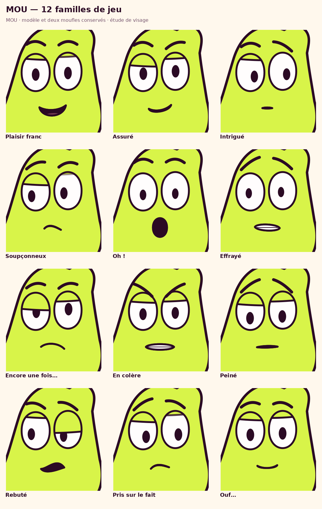

# MOU — bibliothèque d'expressions, version 1

**36 poses de visage : 12 familles × 3 intensités**, avec six courtes
transitions silencieuses. Cette première bibliothèque est un outil de création
pour les épisodes : les poses ont été examinées et corrigées en interne,
mais elles restent à choisir selon la situation et le jeu de MOU.



- [Les 36 expressions : planche1](planches/01_expressions.png), [planche2](planches/02_expressions.png), [planche3](planches/03_expressions.png), [planche4](planches/04_expressions.png).
- [Six transitions de visage — MP4 muet, 18s](MOU_transitions_visage.mp4?raw=true).
- [Télécharger la bibliothèque complète](MOU_bibliotheque_expressions_v1.zip?raw=true).
- [Actions proposées pour clarifier l'épisode de cuisine](intentions_episode.md).
- [Critique indépendante](critique.md) · [comparaison avant/après](controle/comparaison_corrections.png).

## Familles et choix de jeu

Joie, fierté, curiosité, doute, surprise, peur, contrariété, colère,
tristesse, dégoût, gêne et soulagement. Chaque famille comprend une pose
légère, une franche et une exagérée. Les identifiants sont stables, par exemple
`surprise_franc`, `contrariete_leger` ou `gene_franc`.

Une pose isolée ne raconte pas à elle seule une pensée. La gêne peut se lire
comme du souci ou du regret ; le soulagement comme une satisfaction calme.
Le regard vers un objet, l'événement précédent, la posture et la réaction
suivante précisent cette lecture. Les étiquettes ne constituent pas une
classification scientifique ou une validation par le public.

## Utiliser la galerie

1. Télécharger puis décompresser entièrement le ZIP.
2. Ouvrir `bibliotheque/expressions/v1/galerie.html` dans un navigateur.
3. Filtrer par famille, intensité ou situation ; cliquer sur « Voir MOU en pied ».
4. Télécharger le SVG de la pose choisie. Les 36 SVG et PNG transparents sont
   aussi présents dans `exports/`.

La galerie fonctionne hors connexion, avec ses images intégrées et sans compte
ou dépendance web. GitHub affiche les planches directement ; le fichier HTML
s'ouvre localement après téléchargement.

## Voir les transitions

Les six scènes durent trois secondes chacune :

- repos → joie de cuisiner ;
- joie → doute après observation de la main ;
- doute → contrariété devant un nouveau lavage ;
- assurance → surprise devant le petit morceau ;
- peur → soulagement après le nettoyage ;
- repos → gêne devant le gaspillage.

Chaque étude montre d'abord une pose, dirige les pupilles vers un repère,
forme l'expression puis lui laisse un temps de lecture. Un bref clignement
se place pendant la tenue. Il n'y a qu'un contour de bouche à la fois pendant
l'interpolation. Ces essais isolent le visage avec le corps et les bras au
repos ; ils ne remplacent pas une scène avec prise d'objet et jeu corporel.
Les textes sont des repères de bibliothèque, pas des dialogues d'épisode.

## Améliorations déjà faites après critique

La première lecture sans étiquettes a révélé trois confusions :

- Le soulagement en bouche O ressemblait à un bâillement. Il termine désormais
  en sourire détendu, avec des yeux moins lourds.
- Le dégoût ressemblait au scepticisme. Une grimace latérale et un œil plus
  plissé le différencient ; la cible d'aversion reste importante.
- La curiosité et la surprise partageaient une bouche O. La curiosité utilise
  maintenant une bouche fermée et une attention dirigée.

La gêne ne reçoit pas de sourire ajouté qui pourrait la faire lire comme de la
frime. Les [observations et limites](critique.md) restent dans le projet.

## Réutiliser les sources

`catalogue.json` contient l'intention, le regard proposé, les indices du visage,
le contexte et le risque de double lecture de chaque pose. `sources/face.py`
ajoute des contrôles faciaux au modèle canonique sans modifier `mou_rig.py` :
neuf formes de bouche, sourcils, paupières, direction et taille des pupilles.
Les deux bras/moufles, le corps et les pieds des exports en pied reprennent
les dessins natifs avec le raccord de bras déjà corrigé.

Pour intégrer une expression dans un plan existant, employer **le fragment de
visage** `face_fragment(params, uid)` ; les SVG complets sont des personnages
en pied destinés à l'export, pas des calques de visage à superposer au MOU déjà
présent. `blend_face_params(a,b,u)` relie deux poses avec un seul contour et
un seul masque de bouche. Le découpage choisit le moment du regard, du geste
et des pauses ; ce helper ne prend pas ces décisions artistiques.

Pour agrandir le catalogue, ajouter des familles/poses aux mêmes champs,
mettre à jour les nombres déclarés, puis refaire les planches et leur critique.
Le rendu parcourt les entrées du catalogue ; les exemples animés restent six
études choisies explicitement dans `sources/animer.py`.

## Reproduction gratuite et open source

Depuis la racine du dépôt, avec les dépendances de `requirements.txt`, Cairo,
FFmpeg et Node pour le contrôle de syntaxe de la galerie :

```sh
export XDG_CACHE_HOME="$PWD/work/font-cache"
.venv/bin/python -B bibliotheque/expressions/v1/sources/render.py
.venv/bin/python -B bibliotheque/expressions/v1/sources/animer.py
.venv/bin/python -B bibliotheque/expressions/v1/sources/verify.py
.venv/bin/python -B bibliotheque/expressions/v1/sources/package.py
```

Le ZIP inclut les dépendances de dessin du dépôt, les polices, les sources,
la galerie, les PNG/SVG, les vidéos d'étude et les contrôles. Aucun service
payant ni générateur à crédits. L'épisode V22 et son son restent conservés ;
les actions pour son amélioration sont documentées séparément.

[Contrôles techniques](controle/audit.json) : modèle canonique, deux mains,
corps/bras/pieds identiques, masques et bouche uniques, cohérence des sources
avec les exports, décodage vidéo et syntaxe de la galerie. Ces contrôles ne
certifient pas à eux seuls la lecture d'une émotion ou le succès d'un gag.
