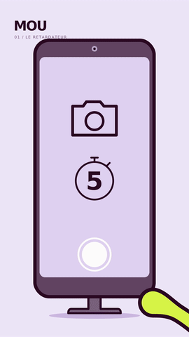

# MOU — Le retardateur, nouvelle réalisation

13secondes ·1080×1920 ·24images/s ·sans dialogue.

MOU est convaincu d’être magnifique. Il pose pour sa photo, abandonne son
sourire trop tôt et se relâche pendant que le1 est encore affiché. Le flash
capture sa déformation. La photo lui fait perdre son assurance.

- **[MP4 avec son](MOU_le_retardateur_nouveau.mp4?raw=true)**
- [Version muette](MOU_le_retardateur_nouveau_muet.mp4?raw=true)
- [Sources, sons et références — ZIP](MOU_le_retardateur_sources.zip?raw=true)
- [Bilan des contrôles](CONTROLE.txt) · [Chronologie](chronologie.json)
- [Reproduire](sources/README.md) · [Provenance](sources/PROVENANCE.txt)

## Création et contrôle

[Scénario](developpement/scenario.md) · [Découpage](developpement/decoupage.md) ·
[Storyboard](developpement/storyboard.json) · [Critique avant fabrication](developpement/critique_scenario.md) ·
[Critique du rendu réel](controle/critique.md) · [Décisions et corrections](developpement/corrections.md).

Cette fabrication repart du gag initial dans un dossier distinct. Le modèle
articulé fourni est conservé ; aucun ancien fichier de episodes/01 n’est réécrit.
Le compteur5→1 reste régulier, la photo n’apparaît qu’après le clic, les bras
gardent le dessin original et les pieds gardent leur contact au sol.

Production locale gratuite/open source : Python, SVG, CairoSVG, Pillow, NumPy,
FFmpeg. Sept sons originaux, sans voix ni musique. La critique est interne,
par extractions chronométrées ; aucun test public ni résultat d’audience.
Le contrôle audio numérique ne vaut pas écoute sur téléphone réel.
La veille externe demeure incomplète, comme indiqué dans editorial/ du dépôt.

Révision2 : bras originaux rétablis ; scénario, poses, expressions, durée et son conservés.
