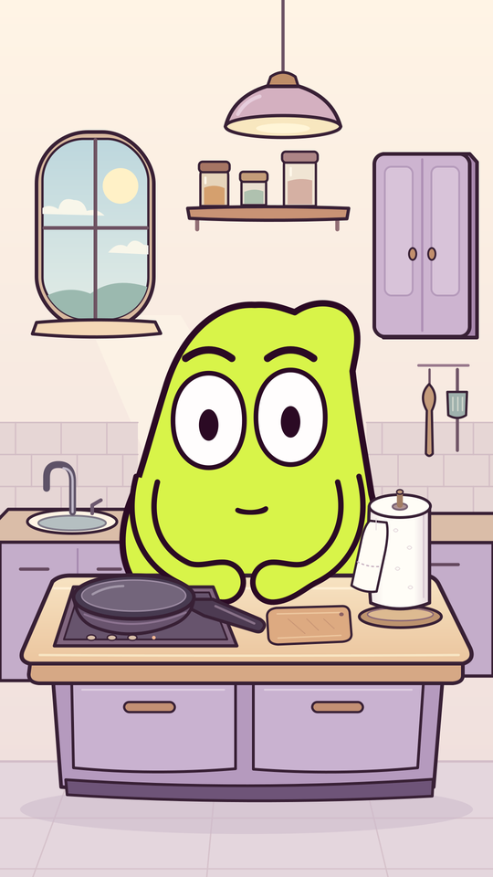

# MOU en cuisine — essuie-tout

Le décor est validé. Étape en cours : **une image fixe de MOU dans la cuisine**,
pour examiner taille et position avant toute animation.

[Image 1080 × 1920](placement/MOU_cuisine_placement.png?raw=true) ·
[Source SVG](placement/MOU_cuisine_placement.svg?raw=true) · [Dossier du placement](placement/)

Le sujet retenu est le réflexe de s’essuyer les mains après chaque contact
pendant que l’on cuisine : remuer la poêle, ajouter des ingrédients, toucher
un manche ou régler le feu. La répétition de l’essuyage et l’excès de papier
portent le gag. La variante où la recette disparaît dans les papiers est écartée.

- [Décor PNG 1080 × 1920](decor/MOU_cuisine_decor.png?raw=true)
- [Source SVG](decor/MOU_cuisine_decor.svg?raw=true)
- [Sources et calques du décor](decor/README.md)

L’utilisatrice demande de travailler petit à petit. Cette étape s’arrête au
placement proposé, à examiner. Aucun mouvement, montage ou son n’est produit.
Les deux précédents films restent archivés.
