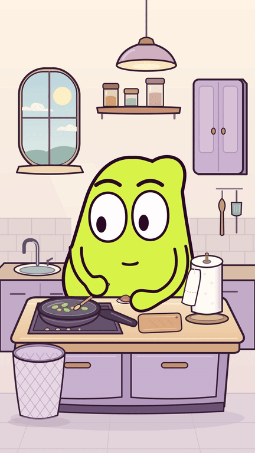
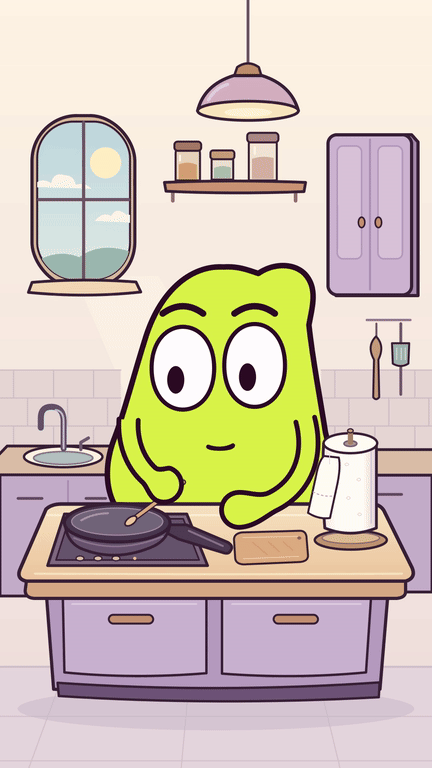
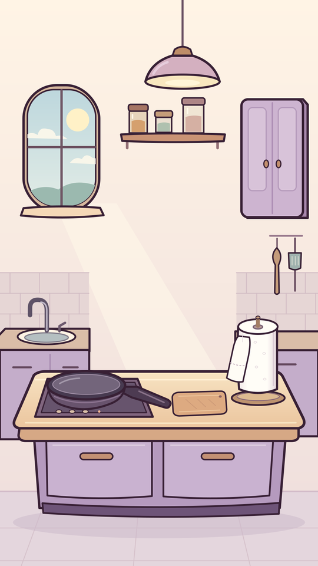

# MOU en cuisine — essuie-tout

**Version courante : [MOU en cuisine, moufle au pouce arrondi,
41 secondes](cuisine_v14/).** [MP4 avec son](cuisine_v14/MOU_Encore_une_feuille.mp4?raw=true),
[muet](cuisine_v14/MOU_Encore_une_feuille_muette.mp4?raw=true),
[sources](cuisine_v14/MOU_Encore_une_feuille_sources.zip?raw=true) et
[contrôles](cuisine_v14/CONTROLE.txt). MOU siffle au départ ; la musique originale
accompagne la cuisine et se coupe pendant les rituels de lavage et essuyage.
MOU remue, coupe la carotte, ajoute la tomate et le sel, puis touche le manche
propre : cinq lavages et autant de papiers jetés. Les inserts du lavabo montrent
le pouce arrondi validé qui frotte contre le bout de la moufle, poignet sec.
Les plans larges, le montage et les sons de la [V13](cuisine_v13/) sont conservés.
[Références internet et limites](cuisine_v6/editorial/veille_cuisine_v6.md).
La [version précédente de 30 s](carotte_v5/), la [version de 29 s](carotte_v4/)
et le montage de 26 s ci-dessous restent conservés.

Le décor, le placement et le test muet de remuage sont validés. Le script corrigé
est accepté : **trois lavages complets pendant la cuisine, beaucoup trop de
papier et une poubelle qui se remplit à chaque jet.**

[Découpage ayant guidé la révision carotte](developpement/decoupage_carotte_v3_propose.md).
[Recherche sourcée d’outils gratuits pour le jeu et le son](../../recherche/README.md).
[Direction de jeu sans dialogue et planche d’expressions](developpement/expressions_v4/README.md).

- **[MP4 avec son,1080×1920,26s](film/MOU_Encore_une_feuille.mp4?raw=true)**
- [Version muette](film/MOU_Encore_une_feuille_muette.mp4?raw=true) · [Sources ZIP](film/MOU_Encore_une_feuille_sources.zip?raw=true)
- [Sources et reproduction](film/sources/) · [Contrôles](film/CONTROLE.txt)
- [Script v2 accepté](developpement/scenario_papier_v2.md) · [Chronologie](chronologie.json)
- [Critique du montage](film/controle/critique_animatique_v1.md) · [Corrections](film/controle/CORRECTIONS.md)
- [Ancien script v1, conservé](developpement/scenario_papier_v1.md)
- [Validation du test de remuage](test_remuer/VALIDATION.md)

[Voir le test de 4 secondes](test_remuer/MOU_test_remuer.mp4?raw=true) ·
[Sources et contrôles](test_remuer/) · [Placement validé](placement/)

Le sujet retenu est le réflexe de s’essuyer les mains après chaque contact
pendant que l’on cuisine : remuer la poêle, ajouter des ingrédients, toucher
un manche ou régler le feu. La répétition de l’essuyage et l’excès de papier
portent le gag. La variante où la recette disparaît dans les papiers est écartée.

- [Décor PNG 1080 × 1920](decor/MOU_cuisine_decor.png?raw=true)
- [Source SVG](decor/MOU_cuisine_decor.svg?raw=true)
- [Sources et calques du décor](decor/README.md)

La demande de script seul a été remplacée par l’accord « oui Go » après la
correction : chaque répétition comprend l’ouverture du robinet, le lavage,
la fermeture, le séchage et le jet. Une animatique avec son précède l’export
complet. Le modèle et les deux moufles restent ceux du rig d’origine ; le
raccord du bras gauche reçoit seulement la correction locale signalée.
Les deux précédents films restent archivés. Le montage attend le retour de
l’utilisatrice ; aucune diffusion sur un réseau social n’est effectuée.
