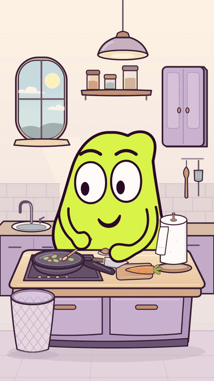

# Encore une feuille — le dernier bout

Révision après le retour sur le couteau, la carotte, le rouleau toujours plein
et la fin. Même personnage et même cuisine : une carotte plus lisible, un
couteau de cuisine qui coupe par le tranchant, et un rouleau qui se consomme.

- **[MP4 avec son — 1080×1920, 30 s](MOU_Encore_une_feuille.mp4?raw=true)**
- [Version muette](MOU_Encore_une_feuille_muette.mp4?raw=true)
- [Animatique avec son](MOU_Encore_une_feuille_animatique.mp4?raw=true)
- [Sources et sons ZIP](MOU_Encore_une_feuille_sources.zip?raw=true)
- [Bilan des contrôles](CONTROLE.txt) · [Critiques et corrections](controle/)
- [Chronologie](chronologie.json) · [Scénario de la correction](developpement/revision_v5.md)
- [Sources et reproduction](sources/README.md)

Après trois grands gaspillages, le quatrième lavage mène au dernier minuscule
bout de papier. MOU découvre le carton nu, puis sèche sa grande moufle avec une
application absurde pour ce petit morceau. La quatrième boulette, minuscule,
rejoint les trois grosses. MOU admire sa main propre ; la recette a peu avancé.

Le rouleau perd du diamètre pendant les tirages et conserve son état entre les
plans. Sa hauteur, son tube et son support restent constants. Le décor maître
validé reste intact ; le rouleau est un accessoire animé dans ce rendu.

Les deux moufles et les fonctions natives de dessin, d’articulation et de raccord
des bras sont conservées. MOU s’engage vers la planche pendant la découpe pour
atteindre le vrai manche sans étirer ses membres. Les lavages restent cadrés
sur le lavabo, le robinet et la main uniquement, à la proportion corrigée.

Production gratuite et open source : Python, SVG, CairoSVG, Pillow, NumPy et
FFmpeg. Bruitages originaux, sans dialogue, musique ou son téléchargé.

[Version précédente de 29 s conservée](../carotte_v4/) ; les contrôles techniques
et la critique des images sont distincts d’un retour de public ou d’une écoute
sur téléphone. Cette version est proposée au jugement de l’utilisatrice.
