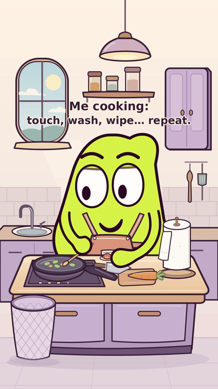

# Encore une feuille — sel et lavage du bout des doigts

MOU remue, découpe la carotte, ajoute la tomate puis une pincée de sel.
Chaque petit contact relance son rinçage, son essuyage et le gaspillage de
papier. Le dernier contact avec le manche propre épuise le dernier petit bout.
La réaction finale souligne sa fierté devant sa main propre et la poubelle pleine.

Le montage dure 41 s. Les gros plans montrent le bout de la moufle native
sous le jet, avec le poignet et l’avant-bras dégagés. Bassin plus profond,
rebord et bonde lisibles ; même cuisine dans les plans larges. Deux mains
natives pour MOU, une seule visible dans l’insert du lavabo, sans doigts ajoutés.

- **[MP4 avec son — 1080 × 1920, 41 s](MOU_Encore_une_feuille.mp4?raw=true)**
- [Version muette](MOU_Encore_une_feuille_muette.mp4?raw=true)
- [Animatique complète avec son](MOU_Encore_une_feuille_animatique.mp4?raw=true)
- [Sources et sons ZIP](MOU_Encore_une_feuille_sources.zip?raw=true)
- [Bilan des contrôles](CONTROLE.txt) · [Critique finale](controle/critique_v13_final.md)
- [Découpage V13](developpement/decoupage_v13.md) · [Étude du lavabo](developpement/lavabo_v13.md)
- [Contrôles détaillés](controle/) · [Reproduire](sources/README.md)
- [V12 de 35 s conservée](../cuisine_v6/)

Légende d’ouverture : **« Me cooking: touch, wash, wipe… repeat. »**
Trois notes sifflées au départ ; musique originale pendant la cuisine,
coupée pendant chaque rituel et la fin. Sons de sel, eau et papier originaux.
Python, SVG, CairoSVG, Pillow, NumPy et FFmpeg, gratuits et open source.

Les critiques distinguent les images réellement examinées, les contrôles
numériques du son et le jugement du public. Aucune écoute perceptive ou
statistique d’audience n’est inventée. Livraison sur GitHub ; aucune diffusion
sur un compte social n’est effectuée.
