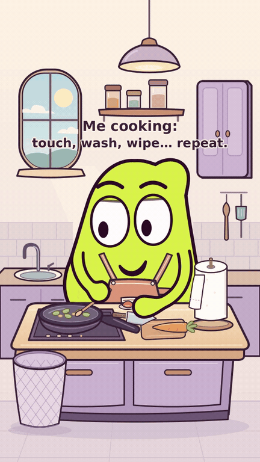

# Encore une feuille — en cuisine et en rythme

Légende au départ, pendant trois secondes : **« Me cooking: touch, wash, wipe… repeat. »**

MOU siffle au début, puis cuisine sur une musique originale légère.
Le montage dure 35 s : quatre tours de cuillère dans une ouverture plus
longue, puis un regard tenu sur la main avant le premier lavage à 7,75 s.
La musique s’interrompt pendant chaque lavage et essuyage, puis reprend
quand il retourne à la cuisine.
Ordre V12 : remuer, découper la carotte, ajouter la tomate, reprendre la
cuillère propre. Chaque contact déclenche son rituel ; la carotte reste
découpée et la tomate attend son lancer avant d’apparaître dans la poêle.
Chaque petit contact relance son lavage avec un débit d’eau exagéré, puis son
gaspillage de papier. Le rouleau se consomme et le dernier petit bout reçoit
un soin démesuré. Le dernier morceau a été agrandi pour rester lisible sur
téléphone : 64 × 88 au lieu de 26 × 40, avec une boulette plus visible.
La retouche V11 garde cette taille et rend la feuille souple : contour légèrement
déformé, bord déchiré et plis courbes, sans coin replié de document. Même prise,
mêmes mains, même durée et même son.

- **[MP4 avec son — 1080×1920, 35 s](MOU_Encore_une_feuille.mp4?raw=true)**
- [Version muette](MOU_Encore_une_feuille_muette.mp4?raw=true)
- [Animatique avec son](MOU_Encore_une_feuille_animatique.mp4?raw=true)
- [Sources et sons ZIP](MOU_Encore_une_feuille_sources.zip?raw=true)
- [Bilan des contrôles](CONTROLE.txt) · [Critique de la légende V10](controle/critique_caption_v10_final.md) · [Rythme V9](controle/critique_rythme_v9_final.md) · [Son V8 conservé](controle/critique_musique_v8_final.md) · [Correctif papier V7](controle/critique_papier_v7_final.md)
- [Retouche du papier V11](developpement/papier_v11.md) · [Critique du résultat V11](controle/critique_papier_v11_final.md)
- [Nouvel ordre V12](developpement/ordre_v12.md) · [Critique V12](controle/critique_ordre_v12_final.md)
- [Ouverture et rythme V9](developpement/ouverture_v9.md)
- [Direction sonore V8](developpement/direction_son_v8.md) · [Chronologie](chronologie.json)
- [Ajouts initiaux V6 conservés](developpement/ajouts_v6.md)
- [Références internet consultées et limites](editorial/veille_cuisine_v6.md)
- [Tes deux exemples YouTube et leur accès](editorial/references_utilisatrice_v7.md)
- [Reproduction](sources/README.md) · [Version précédente conservée](../carotte_v5/)

Tablier attaché au même corps, sous les deux bras ; une seule bouche en O
pendant les trois notes de la phrase initiale, de 0,3 à 1,731 s. Le petit
balancement s’arrête aux contacts précis du couteau et pour les lavages.
Le jet est 3–4 fois plus large, avec des éclaboussures contenues dans le lavabo.
Le modèle, les moufles et les fonctions natives d’articulation sont conservés.

Production gratuite et open source : Python, SVG, CairoSVG, Pillow, NumPy et
FFmpeg. Les 48 bruitages, les trois notes sifflées du départ et la musique
de fond sont originaux ; aucun dialogue, morceau connu ou son téléchargé.
Le sifflement ne revient pas après le premier lavage. La musique se coupe
aux entrées lavabo (7,75 ; 16,5 ; 23 ; 28 s) et reste coupée pendant le papier,
les jets et les zooms. La fin garde seulement le léger son de cuisson.

La veille reste partielle : une vidéo de cuisine examinée par images et une
boucle CSS lue, sans accès actif aux épisodes YouTube. Le brouillon réseau
est enregistré ; son activation nécessite de revoir/enregistrer les paramètres
puis publier l’environnement. Les observations et les propositions originales
pour MOU restent distinguées dans le rapport.

Le correctif papier V7 conservait le son et les actions du montage précédent
(commit `0e188a3`). La main garde sa taille ; seul le morceau et sa forme
froissée sont agrandis. Les études et comparaisons sont dans `controle/`.

Les contrôles techniques et l’examen des images ne sont pas un test public ni
une écoute perceptive sur téléphone. Le montage est proposé au retour de
l’utilisatrice ; aucune diffusion sur un compte social n’est effectuée.
