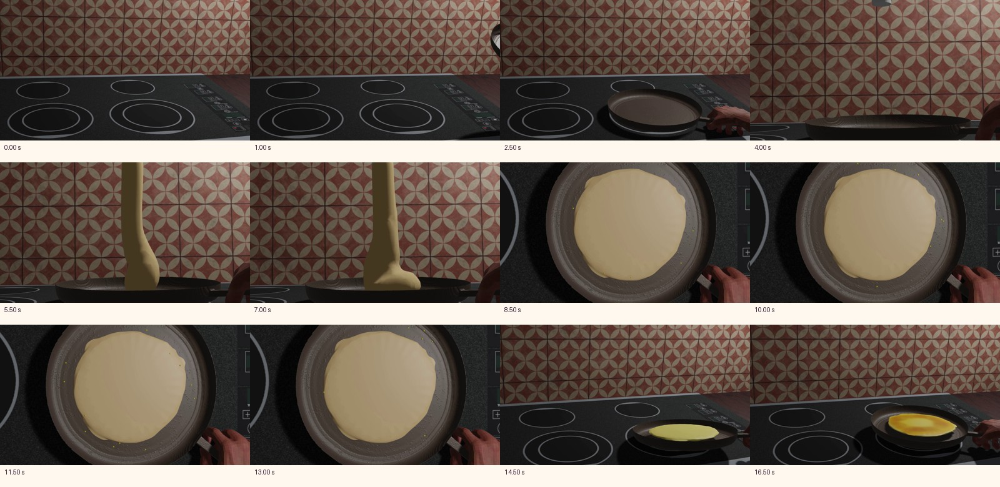

# Veille ciblée — cuisine, rythme et lisibilité

Observation : **28 octobre 2026, Africa/Casablanca**. L’heure exacte de fin de
collecte est conservée dans `donnees/observation.json`.

**État : recherche partielle, pas une veille de 5 à 8 Shorts récents.** Le réseau
actif permet GitHub et ses fichiers bruts ; YouTube, Vimeo et les moteurs de
recherche ne sont pas autorisés dans la politique active examinée. Le coordinateur
prépare l’accès ciblé par le mécanisme de configuration prévu. Aucun contournement
du proxy ou d’un refus n’a été employé.

Une vraie animation courte de cuisine a pu être examinée ; une seconde source
apporte un exemple de cycle rythmique dans son code. Ces deux sources ne sont
pas des épisodes comiques récents et ne permettent aucune conclusion d’audience.

## Références réellement accessibles

| Source | Date vérifiée | Durée et format | Compteurs accessibles | Examen effectivement réalisé |
| --- | --- | --- | --- | --- |
| **UjcicHana — pancake-animation**, [dépôt](https://github.com/UjcicHana/pancake-animation), [vidéo dans GitHub](https://github.com/UjcicHana/pancake-animation/blob/549cee31ffae3a25338a2ce2d064a6730ce2c5ed/final.mp4), [MP4 direct](https://raw.githubusercontent.com/UjcicHana/pancake-animation/549cee31ffae3a25338a2ce2d064a6730ce2c5ed/final.mp4) | Ajout du fichier vidéo le **31 janvier 2025 à 13:40:43 UTC**, par le commit `549cee31…`, titre « Added documentationa and video ». C’est la date de dépôt du fichier, pas une date de publication YouTube. | **17,416667 s**, 1920×1080, 24 images/s, H.264. **Aucune piste audio** dans ce fichier. | Vues, mentions J’aime, rétention : **non accessibles**. Les éventuelles étoiles GitHub ne seraient pas des vues vidéo. | Fichier réellement téléchargé pour examen local, décodé par FFmpeg ; **12 images réparties sur toute la durée ont été ouvertes**. Pas de projection continue revendiquée. |
| **withaarzoo — Animated-Loader**, [dépôt](https://github.com/withaarzoo/Animated-Loader), [code CSS daté](https://github.com/withaarzoo/Animated-Loader/blob/cd76d7e884938775d279ef37357d1010ea98cd33/style.css) | Dernier commit du dépôt vérifié : **4 avril 2023 à 10:07:10 UTC**, `cd76d7e…`. Ce n’est pas une date de diffusion d’un épisode. | Boucle de poêle/crêpe : **2,1 s dans le CSS** (`flip`, `switchSide`, `jump`, `fly`). Boucle infinie, pas un film de 2,1 s. | Aucun compteur d’audience vidéo accessible. | README, HTML et CSS réellement lus. Une capture locale Chromium a été tentée puis a expiré : **aucun rendu visuel de cette boucle ni son n’est revendiqué**. |

Le MP4 de la première référence est conservé seulement dans le dossier de travail
ignoré par Git, pour l’analyse. Il ne devient ni une ressource ni une bande son
du film MOU. Les images réduites ci-dessous servent à documenter la lecture.

## Observations, séparées des propositions pour MOU

### Ce que montrent les images de pancake-animation

- Vers **2,5 s**, la main tient le manche et place la poêle. L’ustensile et sa
  prise restent simultanément visibles.
- Vers **4–7 s**, le cadrage plus proche laisse voir l’arrivée de la pâte dans
  le récipient. On voit la matière et le résultat du geste.
- Vers **8,5–13 s**, la vue du dessus rend la pâte étalée lisible dans la poêle.
- Vers **14,5–16,5 s**, retour à un angle plus large autour de la poêle et de
  la crêpe ; les images montrent le changement de position et le résultat.
- Le fichier ne montre pas le visage d’un cuisinier. Il ne fournit donc pas
  de preuve sur le jeu joyeux, une expression de MOU ou des sifflements.
- L’absence de piste audio ne permet aucune observation de Foley, de mélodie
  ou de synchronisation sonore dans cette référence.

### Ce que permet d’observer le code du loader

- Les animations de la poêle et de la crêpe partagent une période de **2,1 s**.
- Les positions du saut et les rotations changent à des fractions différentes
  du cycle. Les bulles ont d’autres périodes et des délais distincts.
- Ce sont des propriétés effectivement lues dans le code, **pas un jugement
  perceptif de fluidité**. La tentative de rendu a échoué et n’est pas présentée
  comme un visionnage réussi.

### Hypothèses de mise en scène originales pour MOU

Ces propositions viennent du caractère et de la commande de MOU ; elles ne sont
pas attribuées à une scène de chaîne qui n’a pas été visionnée.

1. **Le plaisir avant le rituel.** Sourire gourmand et petit mouvement régulier
   pendant le remuage ou les transitions, puis une très courte phrase sifflée
   originale. Le regard reste dirigé vers le plat ou la prise.
2. **Un motif interrompu, puis repris.** Le lavage coupe le sifflement ; le bruit
   d’eau exagéré crée le contraste avec la cuisine légère. MOU reprend son petit
   motif sans se rendre compte de son excès. Éviter un sifflement permanent qui
   masquerait les coupes, l’eau et le papier.
3. **Stabilité aux contacts.** Le rythme peut animer les préparations et les
   retours à la cuisine. La prise du couteau, ses contacts et les deux rondelles
   doivent rester lisibles ; ne pas transformer ces instants en danse distraite.
4. **Le tablier comme signe immédiat de cuisine.** Le placer sous le visage,
   derrière les deux bras, avec un contour et une couleur qui laissent MOU
   reconnaissable. C’est un ajout explicitement demandé, pas un changement de modèle.
5. **L’eau comme excès visuel et sonore.** Jet plus épais et éclaboussures dans le
   lavabo, sans cacher commande ou main. L’eau doit réellement rejoindre la main
   et le bac ; son volume doit rester distinct du petit sifflement.

Le motif sifflé, sa mélodie et ses timbres doivent être créés pour MOU ; aucune
musique, vidéo, personnage ou gag de ces références n’est repris dans la production.

## Ce qui manque encore à la veille demandée

- Pas de sélection vérifiée de 5 à 8 Shorts récents sur plusieurs chaînes.
- Pas de comparaison à des publications ordinaires de ces mêmes chaînes.
- Pas d’épisode comparable visionné avec un cuisinier qui danse ou siffle.
- Pas de compteurs vidéo accessibles, ni de mesure de rétention.

Les requêtes publiques GitHub sont conservées : « cooking animation », « chef
animation », « cooking cartoon », « whistling animation », puis des recherches
sur des courts et la cuisine. Les résultats étaient principalement des sites,
jeux ou loaders ; ils n’ont pas été rebaptisés « épisodes comparables ». Une
adresse de dépôt supposée de Kitchen Chaos retournait 404 et a été écartée.

## Preuves et reproduction de la collecte

- `donnees/pancake_reference.json` : URL, taille, SHA-256 et résultat FFprobe.
  Empreinte du MP4 : `fb0b34c87c033a0368d98c9c3f5d7a4930088dd22d17534d4a1a0565e00ac0e0`.
- `donnees/pancake_video_history.json` et `pancake_final_history.atom` : date et
  commit de l’ajout du fichier vidéo.
- `donnees/loader_css.txt`, `loader_readme.txt`, `lectures_sources.json` : code
  lu, URL et empreintes. `dates_commits.json` : dates des flux GitHub Atom.
- `donnees/recherches*.json`, `resultats_parses.json`, `candidats_medias.json` :
  requêtes, résultats et candidats examinés.
- `donnees/snapshots_html.json` et `*.html.gz` : réponses HTML compressées,
  avec empreinte du contenu décompressé. Aucun contenu de page ne constitue
  une instruction pour le projet.
- `donnees/observation.json` : heure de collecte, politique active et limite
  de la tentative de capture Chromium.

Aucun fichier d’animation, de son, de modèle ou de configuration de l’environnement
n’a été modifié par ce rôle.
