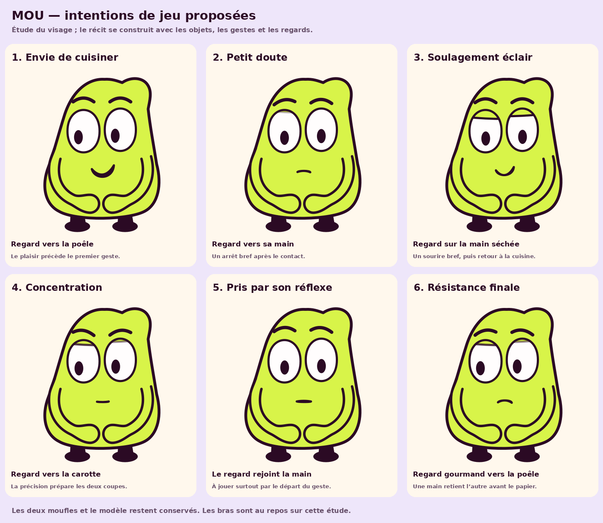

# MOU — étude de jeu sans dialogue

[](MOU_jeu_sans_dialogue.png)

Cette planche rend le **modèle existant** avec six variations du visage et du
regard, pour accompagner le scénario carotte/accélération. Les deux moufles,
les pieds et le raccord corrigé sont conservés. Les bras partagent ici la pose
au repos ; ils ne représentent pas encore la découpe ou le geste de retenue.

Les titres décrivent le travail d’animation. Ils n’apparaîtront pas dans
l’épisode. La gourmandise doit être portée par le regard vers le plat ; le
réflexe par le contact puis le mouvement ; la résistance par l’interception
visible d’une main par l’autre. Une planche de visages seule ne démontre pas
encore que le récit se comprend sans son.

- [Direction complète des huit temps de jeu](../direction_jeu_emotions_v4.md)
- [Critique indépendante de la lecture muette](../critique_lecture_muet_v4.md)
- [Paramètres des six intentions](intentions.json)
- [Source Python](sources/planche.py) et [poses SVG](poses/)

Reproduire depuis la racine du projet :

```sh
XDG_CACHE_HOME="$PWD/work/font-cache" .venv/bin/python -B episodes/03/developpement/expressions_v4/sources/planche.py
```

Python, SVG, CairoSVG et Pillow ; aucun nouveau logiciel ni service génératif.
Le rig et les sources de production ne sont pas modifiés par ce générateur.
La première bouche du cinquième visage ressemblait trop à un sourire ; elle
est reprise en une bouche plus petite et neutre après avis du critique.
