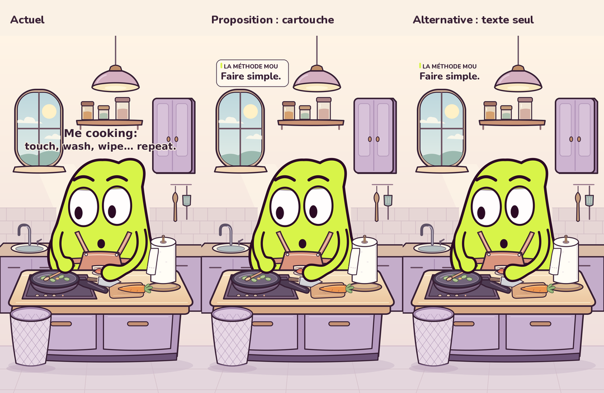

# Proposition de signature : La méthode MOU

L’utilisatrice demande un concept récurrent de phrases pour distinguer la série,
un placement plus haut et un style adapté au personnage et à la cuisine.
Il s’agit d’une proposition éditoriale et de maquettes : aucun MP4, son ou
modèle de MOU n’est modifié. La formule n’est pas encore validée.

## Recommandation

**LA MÉTHODE MOU**, suivie d’une intention très courte. Le texte montre
le petit objectif raisonnable de MOU ; ses gestes montrent sa manière de
s’y prendre. Le contraste peut révéler son besoin de maîtrise, sa gourmandise,
sa curiosité ou sa tendresse. Ne pas imposer un échec ou de la frime à chaque fois.

| Situation | Phrase principale | Adaptation anglaise |
| --- | --- | --- |
| Cuisine actuelle | Faire simple. | Keep it simple. |
| Attente, exemple pour la série | Rester zen. | Stay calm. |
| Vouloir rendre service | Aider un peu. | Just helping. |
| Gourmandise | Juste goûter. | Just a taste. |

Le label anglais est **THE MOU METHOD**. L’anglais reste dans le film actuel ;
les images françaises et anglaises ci-dessous servent à choisir la direction.
Ces exemples ne lancent pas de nouveaux épisodes et ne reprennent pas le
pilote abandonné. La phrase ne doit annoncer ni papier, ni poubelle, ni chute.

Une fois la direction retenue : deux lignes au total, une intention de deux
à quatre mots, présente au début en même temps que l’action pendant environ
trois secondes. Raccourcir la phrase plutôt que multiplier les lignes ou
réduire la police au point de la rendre illisible.

## Images à examiner

[](MOU_signature_proposee.png)

- **[Proposition française : petit cartouche](MOU_signature_proposee.png)**
- [Version anglaise](MOU_signature_english.png)
- [Alternative sans cartouche](MOU_signature_texte_seul.png)
- [Lecture mobile 360 × 640](MOU_signature_proposee_mobile.png)

L’ancienne phrase se trouve vers y500–620 et masque fenêtre/placard. Le
nouveau cartouche occupe x80–468, y128–274 sur le 1080 × 1920, au-dessus de
la fenêtre et à gauche de la lampe. Le bas du cartouche laisse un espace
avant la fenêtre qui commence vers y288. Les positions ont été vérifiées
sur ce décor ; ce ne sont pas des garanties universelles pour les interfaces
de chaque plateforme.

Nunito ExtraBold, prune du décor, fond crème et petit accent citron. Contour
fin, pas d’ombre lourde ni de double bord de texte. Le cartouche évoque une
petite fiche de méthode, cohérente avec l’assurance de MOU et la cuisine.
La version sans cartouche reste possible si l’on préfère une présence plus légère.

## Autres pistes conservées

L’agent éditorial a proposé « Simple. Jusqu’à MOU. » / « Simple. Until MOU. »
(signature qui annonce une complication), « MOU veut juste… » (désir innocent)
et « MOU fait… avec méthode » (fausse maîtrise). Le coordinateur préfère
« La méthode MOU » : adaptation anglaise naturelle, label court, intentions
variables, sans imposer à chaque épisode un MOU systématiquement incapable.
Ce choix reste une recommandation éditoriale à discuter avec l’utilisatrice.

## Sources et vérification

`build_previews.py` reprend le véritable état SVG de l’épisode à 1 seconde,
retire seulement l’ancien calque de titre dans une instance d’étude, puis
dessine les propositions. Les pixels modifiés restent dans la zone haute
gauche ; aucun élément du décor ou du personnage n’est redessiné.
`controle.json` enregistre coordonnées, dimensions et empreinte de la police.

Depuis la racine du dépôt, avec ses dépendances Python :

```sh
XDG_CACHE_HOME="$PWD/work/font-cache" .venv/bin/python -B episodes/03/developpement/signature_mou/build_previews.py
```

Python, SVG/CairoSVG et Pillow sont gratuits et open source. Police Nunito
du projet Nunito, distribuée par Google Fonts sous SIL OFL 1.1 ; police
et licence incluses dans `assets/`. Source du fichier :
https://github.com/google/fonts/tree/main/ofl/nunito.
