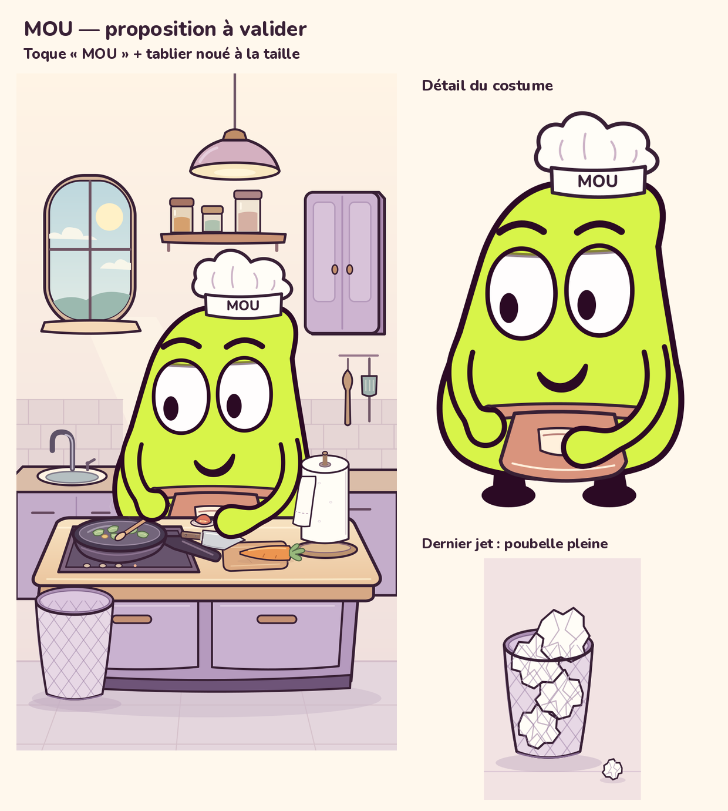

# Costume de chef — image de validation

Proposition demandée par l’utilisatrice, à valider avant de refaire la vidéo.



- Toque courte blanc cassé, contour prune, nom **MOU** sur le bandeau.
- Tablier corail noué à la taille, sans bavette ni bretelles ; poche crème.
- Même personnage, mêmes bras et mains de la V19. Le détail sans îlot montre
  le bas du tablier normalement caché par le plan de travail.
- Chute demandée : la cinquième petite boulette frappe le tas déjà débordant,
  puis tombe au sol à côté. Les quatre grandes boulettes restent dans la
  poubelle. L’image de droite montre seulement ce résultat proposé ; elle
  ne modifie pas l’état de la poubelle au début de l’épisode.

L’image en cuisine est un rendu frais de la pose de 4 s de `cuisine_v19`.
Les nouveaux vêtements sont des calques SVG locaux ajoutés en mémoire,
sous les bras d’origine. Aucun fichier du rig ou de la production V19
n’est modifié ; ni montage ni son ne sont refaits à ce stade.
Les empreintes de contrôle sont dans [controle.json](controle.json).

Sources : [build_preview.py](build_preview.py),
[cuisine SVG](MOU_chef_cuisine.svg), [costume SVG](MOU_costume_detail.svg),
[chute SVG](MOU_chute_papier.svg).

Reproduction depuis la racine du dépôt :

```sh
XDG_CACHE_HOME=/workspace/MOU/work/font-cache .venv/bin/python episodes/03/etudes_costume/chef_v1/build_preview.py
```

Outils gratuits et libres : Python, SVG, CairoSVG et Pillow. Police Nunito
ExtraBold déjà fournie dans `cuisine_v19/assets` sous SIL OFL 1.1.
