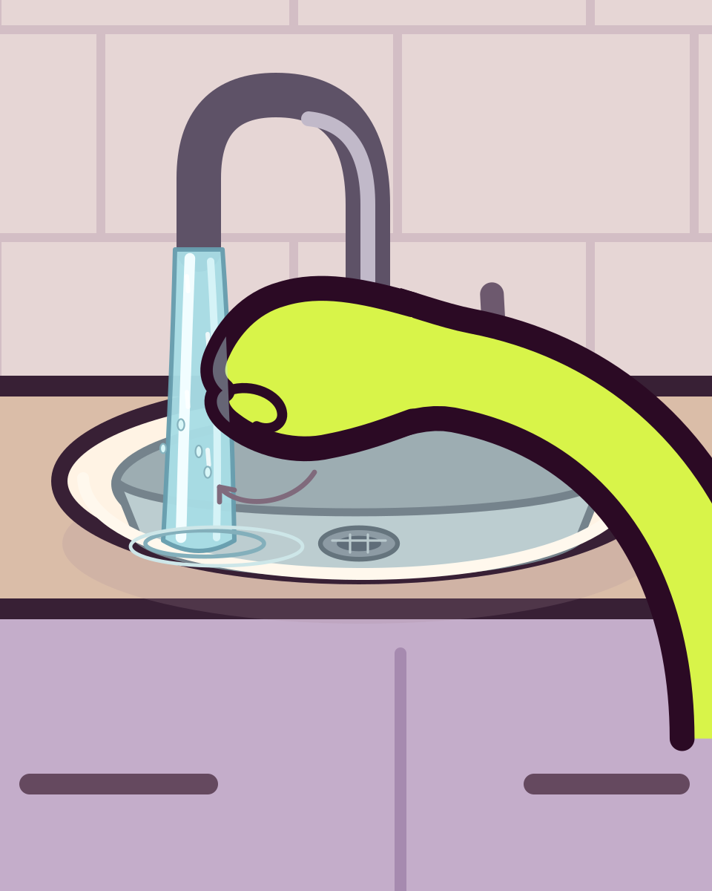

# Proposition de geste à valider

Image seule demandée par l’utilisatrice avant modification de l’animation.
Une seule main : extrémité arrondie repliée contre une petite indication de
pouce, sous le jet ; la flèche représente le frottement circulaire souhaité.
Cette pose de main est une proposition, elle n’est pas encore articulée dans
le rig natif. Le bras, le lavabo, les couleurs et les traits viennent du
projet ; la retouche est limitée au bout de la main dans cette étude.

Image dessinée en SVG et exportée avec CairoSVG, outils gratuits et open source.
Aucun service génératif ni modification de la vidéo V13.
