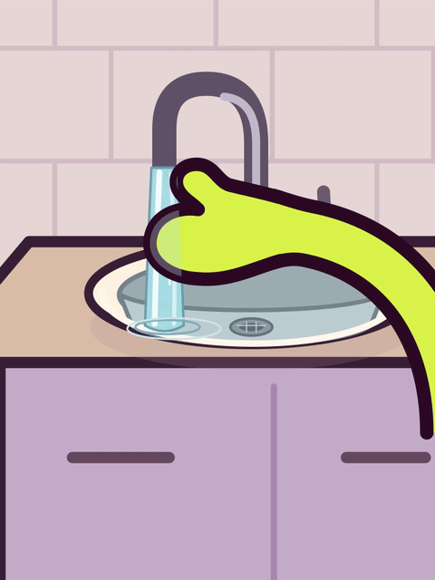

# Moufle avec un pouce distinct — essai à valider

Demande du 29 octobre 2026 : une main comme la référence rapprochée fournie
par l’utilisatrice, avec un vrai pouce saillant et les autres doigts réunis
dans une seule forme arrondie. La proposition précédente avec une petite
boucle intérieure est rejetée ; elle reste archivée dans le dossier parent.

Correctif suivant : dessus du pouce jugé trop triangulaire. Le sommet est
remplacé par un arc large, avec des tangentes continues dans les deux poses
et pendant les frottements. Seul le contour local du pouce est retouché ;
paume, bras, décor, geste et durée de 4 secondes conservés. Voir la critique
du correctif dans `critique_arrondi.md`. La version précédente reste au
commit `fc27956f297c750bd85a69698b125397d2e696a6`.



[Lire le MP4 muet de 4 secondes](MOU_essai_moufle_pouce.mp4).
Image de la silhouette : [MOU_moufle_pouce.png](MOU_moufle_pouce.png).

- 0–0,65 s : silhouette ouverte tenue pour lire le pouce.
- 0,65–1,10 s : le pouce vient contre le bout arrondi de la moufle.
- 1,10–2,90 s : trois petits frottements, pouce mobile par rapport aux doigts.
- 2,90–3,35 s : relâchement ; puis tenue jusqu’à 4 s.

Une seule main, poignet sec ; aucun ongle ni découpe de doigts humains.
La nouvelle forme est limitée à cette étude. Le bras continu à droite,
la palette et le lavabo sont repris de la V13. Le rig canonique, les sources
et les exports de l’épisode ne sont pas modifiés. L’essai n’est pas encore
une nouvelle référence validée du personnage.

Production gratuite et open source : SVG, Python, CairoSVG, Pillow, FFmpeg.
Depuis la racine du dépôt, avec les dépendances installées :

```sh
XDG_CACHE_HOME="$PWD/work/font-cache" .venv/bin/python -B episodes/03/etudes_geste/moufle_pouce/render.py
```

Le script écrit ses PNG intermédiaires dans `work/`, puis exporte les images,
le GIF 480 × 640 à 12 images/s et le MP4 720 × 960 à 24 images/s ici.
Les images de critique sont extraites du vrai MP4 ; le bilan indépendant
figure dans `critique.md`, les caractéristiques et empreintes dans `controle.json`.
La validation demandée porte sur la silhouette et le geste, sans son.
