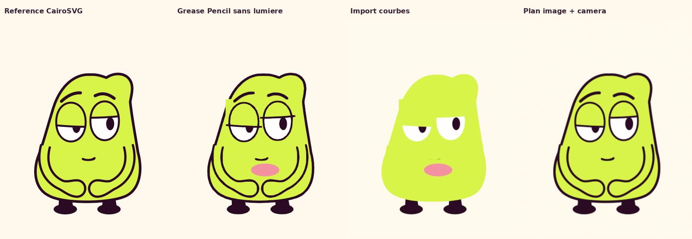

# Outils libres : essais réels pour le jeu et la caméra de MOU

Observation du **29 octobre 2026**, fuseau Africa/Casablanca. Les requêtes
horodatées en UTC, statuts et SHA256 sont dans [preuves/http.json](preuves/http.json).
Deux essais locaux ont été réalisés sur une copie du personnage canonique.
Le film, le rig et les dessins de production n’ont pas été modifiés.

## Décision recommandée

**Ne pas transférer automatiquement le film vers un autre importeur SVG.**
Les essais de Blender et RaveAnima reproduisent un vrai défaut : les masques
SVG des yeux et de la bouche ne sont pas conservés automatiquement. Une langue
apparaît bouche fermée, ou un cache de paupière sort de la silhouette. Un import
qui annonce « réussi » ne prouve donc pas la fidélité du personnage.

**RaveAnima est désormais une piste testée**, avec un adaptateur explicite des
trois masques. Il permet un essai de poses tenues, de courbes et de cadrages
pilotables sans interface. Pour notre prochain test, employer cette chaîne sur
quelques poses du personnage, ou garder CairoSVG comme rendu fidèle des poses.
La nouveauté utile est une feuille d’exposition et une mise en scène préparée,
avec des dessins clés choisis pour leur intention.

**Blender est utilisable pour la caméra et le compositing**, avec des plans
d’images issus de CairoSVG. Son import vectoriel n’est pas une conversion du
rig. Le fichier `.blend` livré dans ce dossier est un petit essai technique
de caméra, pas une scène d’épisode ni un nouveau modèle articulé.

## Quatre candidats et niveau de preuve

| Outil | Licence vérifiée | Ce qui aide MOU | Ce qui a réellement été fait |
| --- | --- | --- | --- |
| [RaveAnima](https://github.com/vibecoderkz/raveanima) 0.2.0, commit `14cfa386…` | [MIT](https://github.com/vibecoderkz/raveanima/blob/main/LICENSE) | Poses/objets, images clés, maintien, interpolation, rendu PNG/MP4 par CLI/Skia. Pilotage MCP annoncé ; CLI effectivement exécuté. | Installation locale isolée, import du SVG natif, correction des trois masques, maintien 0–0,4 s, déplacement puis MP4 de 36 images/1,5 s. [Rapport détaillé](raveanima/rapport.md). |
| [Blender](https://github.com/blender/blender) 4.3.2 local | GPL ; [COPYING](https://github.com/blender/blender/blob/main/COPYING) renvoie au texte GPLv2, fichiers Grease Pencil GPL-2.0-or-later | Caméra orthographique, courbes, poses/image sequences et calques de compositing. | Deux imports SVG réellement rendus, puis plan d’image fidèle et deux cadrages avec clés à 1/18/26/48. Fichier `.blend` avec texture empaquetée fourni. |
| [Friction](https://github.com/friction2d/friction) | [GPL-3.0-only](https://github.com/friction2d/friction/blob/main/LICENSE.md) | Édition vectorielle, morphing de chemins, et **flip book** : une pose affichée à la fois par index d’un groupe. | README, licence et documentation actuels lus. Pas installé ni testé sur MOU aujourd’hui ; aucune fidélité d’import affirmée. |
| [OpenToonz](https://github.com/opentoonz/opentoonz) | [BSD-3-Clause](https://github.com/opentoonz/opentoonz/blob/master/LICENSE.txt), composants tiers séparés | Feuille d’exposition Xsheet pour répartir dessins, pauses, animation en doubles et changements de pose. | README, licence et documentation Xsheet actuels lus. Pas installé ni nouveau rig fabriqué. |

## Test Blender : résultat visuel, pas seulement un import



De gauche à droite : rendu CairoSVG natif, import Grease Pencil sans lumières,
import en courbes, plan d’image avec caméra. Les PNG individuels sont fournis.

- **Grease Pencil** : un objet, sept calques, rendu réellement exécuté.
  L’option de calque `use_lights=False` corrige le premier essai trop sombre.
  Elle ne rétablit pas les masques : rectangle vert au-dessus de la paupière,
  traits de paupières débordants et langue fantôme restent visibles.
- **Courbes** : 24 objets, rendu réellement exécuté avec ordre de profondeur
  déterministe et matériaux émissifs. Les traits de contour et les masques
  ne sont pas reconstruits : résultat impropre à remplacer le personnage.
- **Plan d’image CairoSVG** : silhouette, deux bras/mains, pupilles masquées
  et bouche respectés visuellement. La caméra orthographique fonctionne.
  L’anticrénelage et le filtrage du rendu entraînent une petite différence
  pixel à pixel ; ce n’est pas une copie numérique exacte du PNG source.
- Clés de caméra aux images **1, 18, 26 et 48**, sortie 24 images/s. Deux
  plages de maintien, puis changement vers un gros plan. Courbes Bézier
  `AUTO_CLAMPED`. Le [gros plan réel](mou_camera_closeup.png) et le
  [fichier Blender](mou_camera_probe.blend) sont consultables.

Les différences RGB sont conservées dans [blender_metrics.json](blender_metrics.json).
Elles quantifient ici la fidélité d’un import ; elles ne mesurent ni le jeu
d’acteur, ni le caractère professionnel, ni la compréhension du gag.

## Techniques concrètes à retenir

1. **Exposer des poses fortes avant les transitions.** La Xsheet d’OpenToonz
   décrit le maintien des dessins et les pas 2/3/4. Animer un personnage « en
   doubles » peut être un choix de dessin tout en gardant un montage et une
   caméra à 24 images/s. Cela ne consiste pas à ralentir toute la vidéo.
2. **Choisir les dessins intermédiaires.** Le flip book de Friction affiche
   une seule pose d’un groupe à chaque index. C’est utile pour une paupière,
   une bouche ou une réaction qui doit changer de dessin, au lieu de laisser
   une interpolation continue inventer toutes les expressions.
3. **Séparer personnage et caméra.** Le test Blender montre qu’un cadrage
   peut être tenu, puis changé sans redessiner le rig. Une prise doit montrer
   l’information utile : objet, contact, puis visage. Le logiciel ne choisit
   pas à notre place le bon axe ni le bon instant de coupe.
4. **Contrôler le morphing.** La documentation Friction précise que les clés
   mémorisent les nœuds d’un chemin ; des topologies différentes demandent une
   gestion explicite de nœuds dissous. Un sourire ou une paupière ne devrait
   pas produire une forme accidentelle entre deux dessins clés.

Pour MOU, le prochain test doit donc montrer une action lisible avec une pose
d’attente, une anticipation, un contact et une réaction tenue. Un catalogue de
visages différents ne suffit pas. Ces choix de réalisation ne sont pas des
mesures relevées dans Oggy ; les références Oggy sont traitées séparément.

## Reproduction du test Blender

Les scripts sont aussi conservés dans `work/test_outils_pro/blender/`.
Le SVG de test est une copie des contours natifs de `mou_rig.py` avec une pose
fixe demi-paupières et un petit sourire, choisie pour éprouver les masques.

```sh
.venv/bin/python recherche/2026-10-29_professionnel/outils/prepare_reference.py

XDG_CACHE_HOME=/workspace/MOU/work/test_outils_pro/blender/cache \
BLENDER_USER_CONFIG=/workspace/MOU/work/test_outils_pro/blender/config \
blender --background --factory-startup --python recherche/2026-10-29_professionnel/outils/render_probe.py

XDG_CACHE_HOME=/workspace/MOU/work/test_outils_pro/blender/cache \
BLENDER_USER_CONFIG=/workspace/MOU/work/test_outils_pro/blender/config \
blender --background --factory-startup --python recherche/2026-10-29_professionnel/outils/gp_unlit.py
```

Blender a rendu sans appareil GPU NVIDIA ni service externe. Des messages EGL
ont été consignés au démarrage ; les rendus se sont néanmoins achevés et ont
été examinés. Aucune performance de production d’un épisode entier n’en est
déduite. L’import, les shaders, les masques et le transfert du rig sont des
problèmes distincts.

Sources de méthodes effectivement lues :
[Friction — techniques](https://github.com/friction2d/friction2d.github.io/blob/main/documentation/animation_techniques.md),
[OpenToonz — Xsheet](https://github.com/opentoonz/opentoonz_docs/blob/master/source/working_in_xsheet.rst).
Un chemin de documentation OpenToonz essayé a répondu 404 ; il est conservé
dans les preuves HTTP et n’est pas présenté comme une source consultée.
