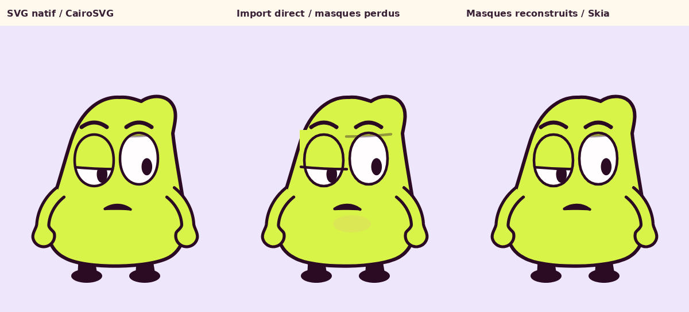

# RaveAnima — essai local réel

Observation du 29 octobre 2026, horodatages UTC dans `fetches.json`.
Copie testée : version **0.2.0**, commit
`14cfa3866655aec8f89419528c17f6fee2d7a03a`.

**Résultat : le CLI fonctionne sans fenêtre, mais l’import SVG direct ne
préserve pas les masques du personnage.** Trois groupes de clipping ajoutés
manuellement dans le document rétablissent le rendu de la pose testée.

## Sources vérifiées aujourd’hui

- [Dépôt et README](https://github.com/vibecoderkz/raveanima/tree/14cfa3866655aec8f89419528c17f6fee2d7a03a).
- [Licence MIT](https://github.com/vibecoderkz/raveanima/blob/14cfa3866655aec8f89419528c17f6fee2d7a03a/LICENSE).
- [CLI](https://github.com/vibecoderkz/raveanima/blob/14cfa3866655aec8f89419528c17f6fee2d7a03a/packages/headless/src/cli.ts).
- [Import SVG](https://github.com/vibecoderkz/raveanima/blob/14cfa3866655aec8f89419528c17f6fee2d7a03a/packages/core/src/svg-import.ts).
- [Types de groupes et clipping](https://github.com/vibecoderkz/raveanima/blob/14cfa3866655aec8f89419528c17f6fee2d7a03a/packages/core/src/types.ts).

HTTP 200, empreintes et copies README/licence conservés ici. Node local
24.19.0 satisfait le minimum annoncé 22.12. Aucun serveur MCP, interface
Tauri, service cloud ou modèle génératif n’a été installé.

## Installation bornée réellement exécutée

Clone local de 13 Mio dans `work/test_outils_pro/raveanima/repo`.
Installation du seul workspace headless : 100 packages, environ 92 Mio.
Scripts d’installation désactivés ; paquet natif Skia précompilé chargé.

```sh
npm ci --workspace @raveanima/headless --include-workspace-root=false --omit=dev --ignore-scripts --no-audit --no-fund --cache /workspace/MOU/work/test_outils_pro/raveanima/npm-cache
```

La première tentative échouait car le cache npm par défaut sous `/home/agent`
n’était pas accessible. Le cache local à l’essai a résolu ce problème sans
changer HOME, les proxys, les certificats ou les permissions globales.

## Tests effectués

Une copie SVG de MOU issue de `mou_rig.character_fragment`, avec une paupière
basse et bouche légèrement ouverte, a été rendue par CairoSVG puis importée
en **36 nœuds éditables**. Le CLI a annoncé `warnings: []`.

L’image importée montre pourtant un rectangle vert hors de la silhouette,
un trait de paupière débordant et la langue sous la bouche : `clip-path`
n’est pas rétabli par cet import. Le code de l’importeur ignore les éléments
`clipPath` ; son absence d’avertissement ne prouve donc pas la fidélité.



Sur une seconde copie `.anima`, les contours canoniques des yeux et de la
bouche ont été dupliqués comme premiers enfants de trois groupes `clip=true`.
Le rendu Skia résultant restaure les masques. **Corps et bras inchangés.**
L’erreur RGB moyenne globale face au PNG CairoSVG passe de 0,491 à 0,202
sur l’échelle 0–255. Ce chiffre décrit cette image ; il n’est pas une mesure
de qualité artistique, et des différences d’anticrénelage subsistent.

Un autre test de chronologie a utilisé un maintien, puis une translation
horizontale : images à 0 et 0,4 s identiques octet par octet ; image à 1 s
différente ; export FFmpeg de **36 images à 24 images/s, durée 1,5 s**.
Ce test prouve le maintien et l’interpolation programmables. Il ne constitue
pas un nouvel essai de jeu émotionnel ni un nouveau film MOU.

Entrées JSON/SVG, document à masques reconstruits et résultats numériques
sont fournis dans ce dossier. Les autres rasters, le MP4 technique et le
clone restent dans `work/test_outils_pro/raveanima/`.

## Conséquence pour MOU

RaveAnima est utilisable comme éditeur de poses et de courbes, avec commandes
annulables, morphing de chemins et rendu CPU. Le test dépasse la lecture du
README. **Une migration automatique du rig actuel reste déconseillée.**
Il faudrait un adaptateur de masques et une revue de chaque expression,
des pivots et des accessoires ; l’image de cuisine et tous ses effets SVG
n’ont pas été validés ici. La caméra peut être organisée par transformations
de groupes, mais seul le déplacement horizontal a été testé dans cet essai.

L’intérêt immédiat est une feuille d’exposition explicite : poses clés,
durées tenues et transitions choisies. Cet outil ne choisit ni l’intention,
ni une bonne silhouette, ni les pauses comiques à la place du réalisateur.
