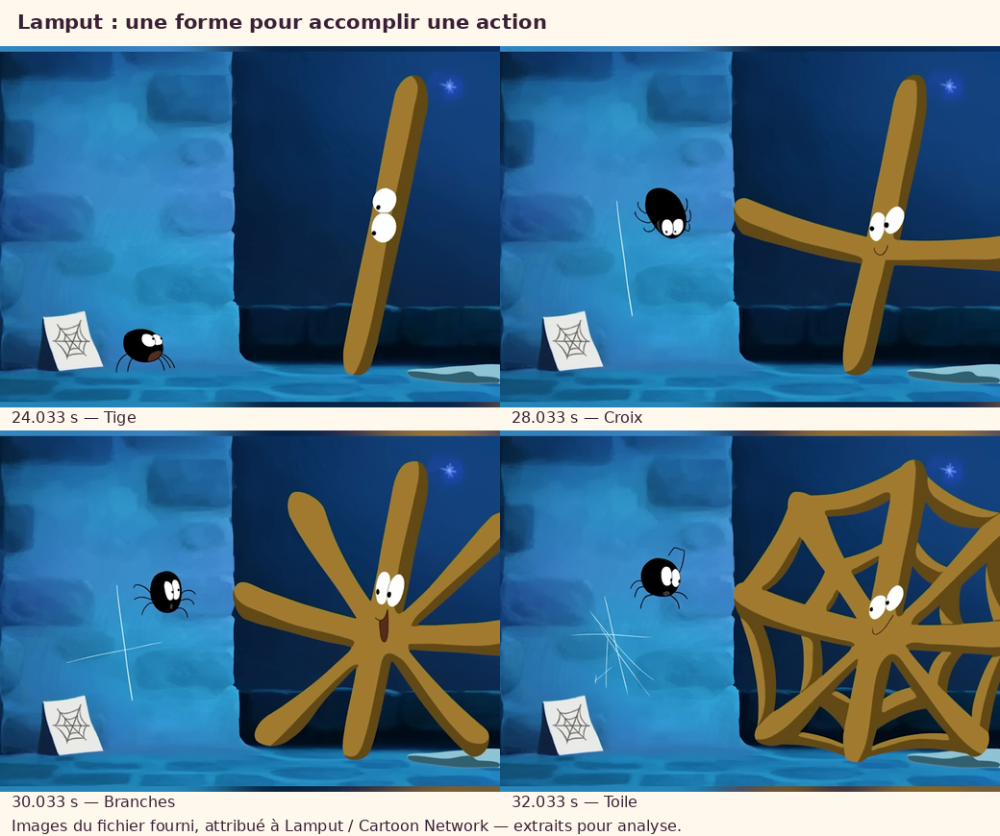

# Lamput : étude visuelle du fichier fourni

**30 octobre 2026, Africa/Casablanca.** L'extrait fourni est enfin accessible :
« Spider Squad Activated 🕷️🧡 #spookyseason.mp4 », 11 812 764 octets,
720 × 1280, cadence nominale30images/s, vidéo112,9s. Origine Lamput / Cartoon
Network attribuée par l'utilisatrice ; date de publication, compteurs et
correspondance exacte aux liens YouTube précédents non vérifiés.

Le coordinateur a réellement ouvert cinq planches d'ensemble et une séquence
plus dense sur16,233–19,033s. Deux agents ont examiné indépendamment le jeu et
le découpage, avec d'autres extractions denses et des coupes image à image.
Il s'agit d'une **analyse d'images successives**, sans revendication de lecture
continue ni d'écoute de la bande-son. Les horodatages correspondent aux PTS
source ; la première image est à0,033333s.

## Ce que raconte la séquence

Lamput rencontre une araignée dont les tracés ne correspondent pas au modèle
de toile montré sur papier. Il l'aide en devenant progressivement un modèle
avec son propre corps. L'araignée participe ensuite à sa protection contre
les moustiques et le rattrape pendant sa chute. La lecture d'entraide repose
sur l'ordre des événements visibles : l'objet introduit au début obtient une
fonction dans la suite. Elle ne nécessite pas d'inventer des répliques.

## Trois enseignements observés

### La déformation sert une action

Entre environ23et33s, la tige devient croix, étoile puis toile. Les formes
restent reconnaissables pendant les essais de l'araignée : la transformation
ne remplace pas l'état lisible qui l'accompagne. Une fenêtre examinée de
23,633à24,633s expose la tige ;27,233à29,033s, la croix. Il s'agit de maintiens
de silhouette avec petites réactions, pas de gels exacts de l'image.

Ces quatre images sont de courts extraits illustrant l'analyse, recadrés
uniquement pour retirer le flou périphérique du montage vertical. Le fichier
original et la bibliothèque complète d'images restent dans work/, hors Git.
Elles ne constituent pas des éléments graphiques à réutiliser dans MOU.

### Le corps répond à une cause physique

Vers53–58s, le fil est tendu entre araignée et moustique. Quand le moustique
libère sa trompe, l'araignée perd cette tension, bascule puis se replie au sol.
La contraction est donc le résultat d'une force relâchée. Une simple vue à
2s d'intervalle pouvait faire lire de la fatigue ; les images denses corrigent
cette première lecture. Cause, geste et résultat doivent rester identifiables.

### L'émotion mobilise plusieurs parties du personnage

Vers98,2s, les yeux de Lamput se dirigent vers l'araignée ; vers99,53s,
le grand sourire et les bras ouverts apparaissent après une vraie fermeture
antérieure du corps. Regard, bras et silhouette portent la même intention.
Un autre passage,16,233–19,033s, passe de l'araignée et de son tracé à Lamput
regardant vers elle, puis joignant les mains avec les yeux serrés et un sourire.
Ces successions soutiennent une lecture émotionnelle ; elles ne mesurent pas
la compréhension d'un public.

## La caméra apporte une information

Trois coupes ont été vérifiées par leurs images consécutives :

- **9,067s** : révélation de l'araignée et du modèle de toile.
- **33,4s** : contact déjà établi en large, puis embrassade en gros plan.
- **53,1s** : plan à deux avec fil tendu, puis effort de l'araignée.

Le flou décoratif haut/bas du format vertical n'est pas considéré comme un
mouvement de caméra. Ces exemples montrent une organisation cause, contact,
réaction, pas une nécessité de zoomer en permanence.

## Proposition concrète pour MOU

Premier test proposé : **la découverte du dernier petit papier**, avant une
nouvelle fabrication du film entier. Préparer quelques poses lisibles :

| Temps de jeu proposé | Intention visible et contrôle |
| --- | --- |
| Attente | MOU s'attend à obtenir son grand morceau habituel ; regard vers le papier, prise déjà cohérente. |
| Anticipation puis tirage | Le corps se resserre pendant l'effort, puis s'étire brièvement avec la traction. Les pieds, la prise du papier et les raccords des bras restent contrôlés. |
| Déchirure puis retour | Le relâchement a la déchirure pour cause ; un seul retour vers une pose lisible, réglé par quelques dessins clés. |
| Découverte | Yeux dirigés vers la petite feuille, arrêt du geste, visage et attitude accordés à une émotion principale. |
| Réaction tenue | Laisser lire le constat avec une silhouette stable et un petit mouvement du regard si utile. Ne pas faire défiler plusieurs grimaces. |

Ceci est une **proposition de jeu à éprouver**, pas une correction déjà rendue.
Les durées seront réglées sur le test MOU, sans recopier les temps de cet
extrait plus long. Dans le code courant, `mou_rig.py` définit une silhouette
fixe et la fin V22 maintient la même transformation du corps : davantage de
jeu corporel exige donc la préparation de poses cohérentes, pas seulement des
valeurs de bouche différentes. Les deux bras, deux moufles, deux yeux, pieds,
identité et costume restent les références communes. Aucune transformation
en toile ou multiplication de membres n'est proposée.

Le film MOU, ses sources d'animation et son mix sont conservés dans cette étude.
Le bruitage peut ensuite accompagner les contacts réellement visibles ; cette
analyse n'évalue pas la musique ni le confort auditif de Lamput ou du mix MOU.

## Rapports et preuves

- [Jeu, déformations et anticipation](jeu/rapport.md) · [preuves](jeu/preuves.json).
- [Découpage, causalité et rythme](decoupage/rapport.md) · [preuves](decoupage/preuves.json).
- [Source, empreinte et échantillons](source.json).
- [Provenance des quatre images commentées](illustration_provenance.json).

L'étude ne constitue pas une veille récente de succès YouTube, une analyse
audio ou une validation professionnelle du prochain épisode. Aucun nouveau
logiciel n'a été installé et aucune nouvelle vidéo MOU n'a été exportée.
